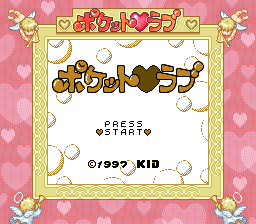
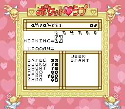
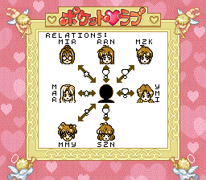
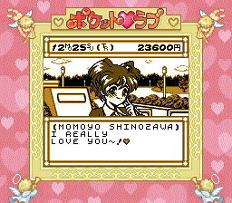

# English Translation for Pocket Love (1997)

This include the translations (`out/bank_*_tr_en.json`) as well as scripts to analyze and patch the original ROM

## Guide

I have also included some notes about the stat values used to trigger endings.

[see guide/guide.md](./guide/guide.md)

## Notes

As the decomp was done by hand, I have kept a diary of the project to detail how long something like this might take. I have also included various notes scattered about which might help other developers (or LLM) understand my path of thought. There are some notes on unlocking all items or all girls as well as some time travel notes if you want to skip around while playing.

I have taken several breaks during the project so I have tried to label each day where at least ~1 hour was done. I estimate that the project took close to 200 hours. many of the early days were 6-8 hours though the ending days of just translating the text were usually only one or two hours each.